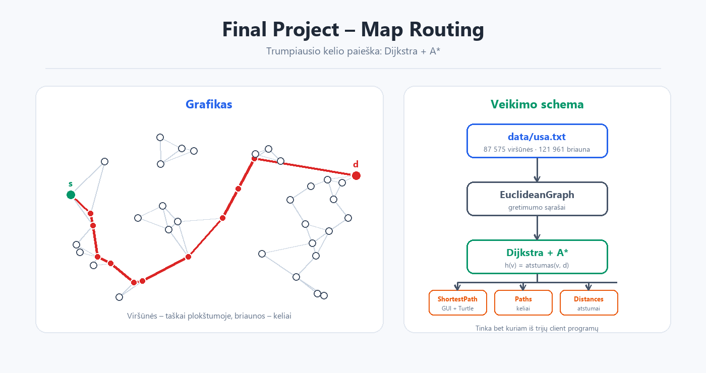

# Final Project – Map Routing


**Tema:** trumpiausio kelio paieška kelių žemėlapyje.  
**Užduotis:** Princeton University COS 226 „Map Routing“ (2004), sukurta Robert Sedgewick ir Kevin Wayne.



## Apie

Projektas sprendžia trumpiausio kelio uždavinį plokštumos grafike, kuriame viršūnės yra taškai, o briaunų svoriai – Euklidiniai atstumai. Naudojamas Dijkstra algoritmas su A* euristika ir ankstyvu sustabdymu, kai tikslą pasiekiama pirmą kartą.

**Užduoties nuoroda:** <https://www.cs.princeton.edu/courses/archive/spring04/cos226/assignments/map.html>

## Turinys

| Failas | Paskirtis |
|---|---|
| `untitled/src/EuclideanGraph.java` | Grafo struktūra ir gretimumo sąrašai |
| `untitled/src/Dijkstra.java` | Dijkstra algoritmas su A* euristika |
| `untitled/src/IndexPQ.java` | Indeksuota prioritetų eilė |
| `untitled/src/Point.java` | Taškas plokštumoje |
| `untitled/src/ShortestPath.java` | Vieno maršruto atvaizdavimas su Turtle grafika |
| `untitled/src/Paths.java` | Kelių spausdinimas konsolėje |
| `untitled/src/Distances.java` | Atstumų spausdinimas konsolėje |

## Duomenys

- `untitled/data/usa.txt` – pilnas JAV kelių grafikas (87 575 viršūnės, 121 961 briauna).
- `untitled/data/usa-*.txt` – užklausų poros (`source destination`), naudojamos kaip `stdin`.
- `untitled/data/input6.txt` – mažas 6 viršūnių pavyzdys.
- `untitled/data/grid*.txt` – tinklelio tipo grafikai.

## Kaip paleisti

### IntelliJ IDEA

1. Atidarykite katalogą `Final Project/untitled` kaip projektą.
2. Nustatykite JDK 8 arba naujesnį.
3. Paleiskite `ShortestPath` su programos argumentu `data/usa.txt`.
4. Įsitikinkite, kad **working directory** yra `Final Project/untitled`, nes duomenys skaitomi santykiniu keliu.

### Komandinė eilutė

```bash
cd "Final Project/untitled"
javac -d out $(find src -name "*.java")
```

**ShortestPath (GUI + Turtle):**

```bash
java -cp out ShortestPath data/usa.txt
```

> `ShortestPath` šiuo metu nuskaito užklausas iš `data/usa-100short.txt` (kelias įrašytas programoje) ir atvaizduoja rastus maršrutus.

**Paths (maršrutai į konsolę):**

```bash
java -cp out Paths data/usa.txt < data/usa-10.txt
```

**Distances (tik atstumai):**

```bash
java -cp out Distances data/usa.txt < data/usa-10.txt
```

**Mažas pavyzdys:**

```bash
echo "0 5" | java -cp out Paths data/input6.txt
```

Windows PowerShell:

```powershell
"0 5" | java -cp out Paths data/input6.txt
```

## Naudojami optimizavimai

- **A\* euristika:** `h(v) = atstumas(v, d)` – prie prioriteto pridedamas Euklidinis atstumas iki tikslo.
- **Ankstyvas sustabdymas:** paieška baigiama, kai tikslas išimamas iš prioritetų eilės.
- **Indeksuota prioritetų eilė:** `IndexPQ` leidžia keisti esamo elemento prioritetą.

## Šaltiniai

- Užduotis: [Princeton COS 226 – Map Routing](https://www.cs.princeton.edu/courses/archive/spring04/cos226/assignments/map.html)
- Pradinį kodą parengė Robert Sedgewick ir Kevin Wayne (Copyright © 2004).
- Papildomi pagalbiniai failai (`In.java`, `StdIn.java`, `Turtle.java`) naudojami tik duomenų skaitymui ir rezultatų atvaizdavimui.
