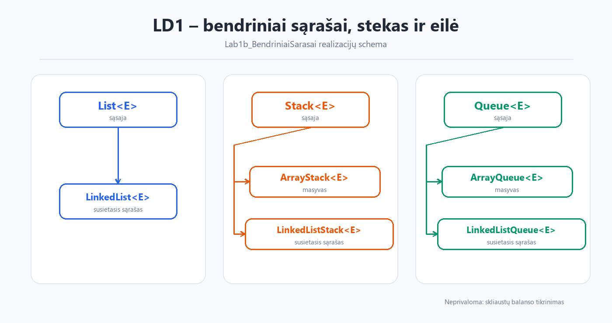

# LD1 – bendriniai sąrašai, stekas ir eilė


**Tema:** susietasis sąrašas, stekas ir eilė.  
**Darbas:** KTU IF kursas „Duomenų struktūros ir algoritmai“.



## Projektai

| Katalogas | Turinys |
|---|---|
| `Lab1b_BendriniaiSarasai/` | Pagrindinis LD1 projektas: bendrinis `LinkedList`, stekas ir eilė |
| `Lab1_prat2/` | Papildoma užduotis su žaidėjų ir komandų sąrašais |
| `LD1_intro/` | Įvadinis darbas: `Array` ir `LinkedList` palyginimas |

## Ką apima

- `Stack<E>` ir `Queue<E>` sąsajos bei jų realizacijos:
  - `ArrayStack<E>`, `LinkedListStack<E>`
  - `ArrayQueue<E>`, `LinkedListQueue<E>`
- Susietojo sąrašo (`LinkedList<E>`) operacijos.
- Neprivaloma užduotis – skliaustų sekos balanso tikrinimas (`ManualTest`).
- `Lab1_prat2` – žaidėjų grupavimas pagal pozicijas ir geriausios komandos paieška.
- `LD1_intro` – studentų sąrašo apdorojimas naudojant masyvą ir susietąjį sąrašą.

## Kaip paleisti

### IntelliJ IDEA

1. Atidarykite norimą projektą, pvz. `Lab1/Lab1b_BendriniaiSarasai`.
2. Nustatykite JDK (8 arba naujesnį).
3. Paleiskite pagrindinę klasę:
   - `com.ktu.ManualTest` – LD1 demonstracija
   - `com.ktu.SimpleBenchmark` – paprastas greitaveikos testas
   - `com.company.Main` – `Lab1_prat2` ir `LD1_intro` projektuose

### Komandinė eilutė

**Lab1b_BendriniaiSarasai**

```bash
cd Lab1/Lab1b_BendriniaiSarasai
javac -d out $(find src -name "*.java")
java -cp out com.ktu.ManualTest
```

Windows PowerShell:

```powershell
cd Lab1\Lab1b_BendriniaiSarasai
$files = Get-ChildItem -Recurse src -Filter *.java | ForEach-Object FullName
javac -d out $files
java -cp out com.ktu.ManualTest
```

**Lab1_prat2**

```bash
cd Lab1/Lab1_prat2
javac -d out $(find src -name "*.java")
java -cp out com.company.Main
```

**LD1_intro**

```bash
cd Lab1/LD1_intro
javac -d out $(find src -name "*.java")
java -cp out com.company.Main
```

> Programas reikia paleisti iš atitinkamo projekto katalogo, nes duomenų failai (`Duomenys/ban.txt`, `U21a.txt`, `U21b.txt`, `students_data.txt`) skaitomi pagal santykinį kelią.
