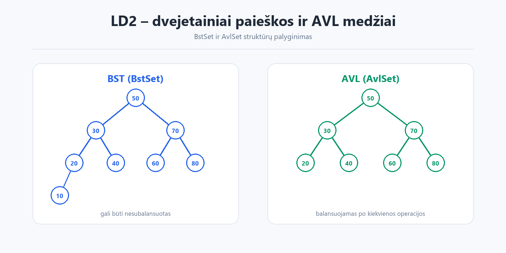

# LD2 – dvejetainiai paieškos ir AVL medžiai


**Tema:** dvejetainis paieškos medis (BST) ir balansuojamas AVL medis.  
**Darbas:** KTU IF kursas „Duomenų struktūros ir algoritmai“.



## Turinys

- `edu.ktu.ds.lab2.utils` – `BstSet`, `AvlSet`, `BstSetIterative` ir pagalbinės sąsajos.
- `edu.ktu.ds.lab2.gui` – Swing vartotojo sąsaja (`MainWindow`).
- `edu.ktu.ds.lab2.demo` – demonstracija, rankiniai testai ir JMH benchmark.
- `src/test` – JUnit testai (`ExampleTests`).
- `data/ban.txt` – pavyzdiniai duomenys.

## Ką apima

- Dvejetainio paieškos medžio operacijos: paieška, įterpimas, šalinimas, aibės operacijos.
- AVL medžio balansavimas ir šalinimas.
- Rezultatų peržiūra per GUI ir konsolę.
- JMH greitaveikos palyginimas.

## Kaip paleisti

### IntelliJ IDEA

1. Atidarykite katalogą `Lab2_AibesMedziai` kaip Maven projektą.
2. Nustatykite JDK 11 (arba naujesnį).
3. Paleiskite vieną iš klasių:
   - `edu.ktu.ds.lab2.demo.DemoExecution` – GUI
   - `edu.ktu.ds.lab2.demo.ManualTest` – konsoliniai testai
   - `edu.ktu.ds.lab2.demo.Benchmark` – JMH benchmark

### Komandinė eilutė

```bash
cd Lab2_AibesMedziai

# Kompiliuoti ir supakuoti
mvn clean package

# GUI
java -cp target/classes edu.ktu.ds.lab2.demo.DemoExecution

# Konsoliniai testai
java -cp target/classes edu.ktu.ds.lab2.demo.ManualTest

# JUnit testai
mvn test

# JMH benchmark
java -jar target/benchmarks.jar
```

> GUI naudoja `src/main/resources` esančius `messages.properties` ir `ktu.png`, todėl paleidžiant per `mvn` jie įtraukiami automatiškai. Paleidžiant rankiniu būdu, į classpath reikia įtraukti `target/classes`.
