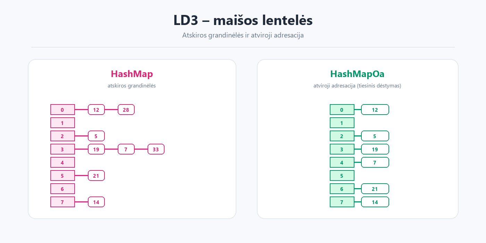

# LD3 – maišos lentelės


**Tema:** maišos lentelės ir kolizijų sprendimo metodai.  
**Darbas:** KTU IF kursas „Duomenų struktūros ir algoritmai“.



## Turinys

- `edu.ktu.ds.lab3.utils` – `HashMap` (atskiros grandinėlės), `HashMapOa` (atviroji adresacija), maišos funkcijos ir pagalbinės sąsajos.
- `edu.ktu.ds.lab3.gui` – Swing vartotojo sąsaja (`MainWindow`).
- `edu.ktu.ds.lab3.demo` – demonstracija, rankiniai testai ir JMH benchmark.
- `src/test` – JUnit testai (`ExampleTests`).
- `diagrams/` – PlantUML klasių diagramos.
- `data/` – pavyzdiniai duomenys (`ban.txt`, `cars.txt`, `zodynas.txt`).

## Ką apima

- Maišos lentelė su atskiromis grandinėlėmis (`HashMap`).
- Maišos lentelė su atviraja adresacija (`HashMapOa`).
- Skirtingos maišos funkcijos ir kolizijų sprendimo strategijos.
- Rezultatų peržiūra per GUI ir konsolę.
- JMH greitaveikos palyginimas.

## Kaip paleisti

### IntelliJ IDEA

1. Atidarykite katalogą `Lab3_MaisosLenteles` kaip Maven projektą.
2. Nustatykite JDK 11 (arba naujesnį).
3. Paleiskite vieną iš klasių:
   - `edu.ktu.ds.lab3.demo.DemoExecution` – GUI
   - `edu.ktu.ds.lab3.demo.ManualTest` – konsoliniai testai
   - `edu.ktu.ds.lab3.demo.Benchmark` – JMH benchmark

### Komandinė eilutė

```bash
cd Lab3_MaisosLenteles

# Kompiliuoti ir supakuoti
mvn clean package

# GUI
java -cp target/classes edu.ktu.ds.lab3.demo.DemoExecution

# Konsoliniai testai
java -cp target/classes edu.ktu.ds.lab3.demo.ManualTest

# JUnit testai
mvn test

# JMH benchmark
java -jar target/benchmarks.jar
```

> GUI naudoja `src/main/resources` esančius `messages.properties` ir `ktu.png`, todėl paleidžiant per `mvn` jie įtraukiami automatiškai.
