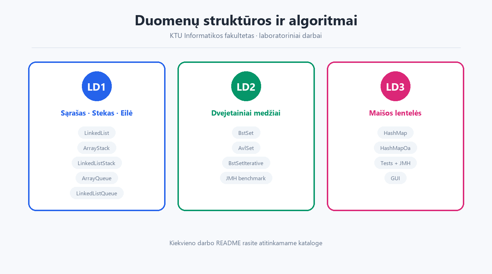
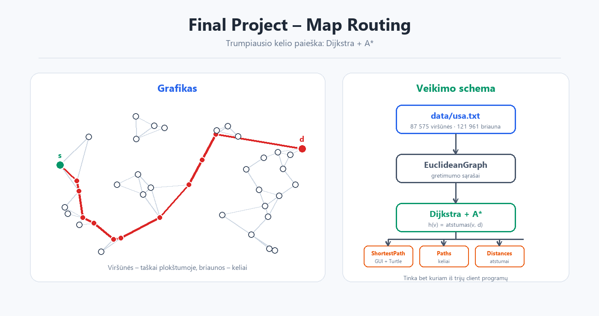

<p align="center">
  
</p>

<h1 align="center">Duomenų struktūros ir algoritmai</h1>
<p align="center">KTU Informatikos fakulteto laboratorinių darbų sprendimai</p>



## Apie

Šiame repozitoriume pateikti kurso **„Duomenų struktūros ir algoritmai“** laboratorinių darbų sprendimai. Kiekvienas darbas turi atskirą `README.md` su trumpu užduoties aprašymu ir paleidimo instrukcijomis.

## Laboratoriniai darbai

| Darbas | Tema | Katalogas | Technologijos |
|---|---|---|---|
| **LD1** | Susietasis sąrašas, stekas, eilė | [`Lab1/`](Lab1/) | Java 8+ |
| **LD2** | Dvejetainis paieškos medis, AVL medis | [`Lab2_AibesMedziai/`](Lab2_AibesMedziai/) | Java 11, Maven, JMH |
| **LD3** | Maišos lentelės (grandinėlės ir atviroji adresacija) | [`Lab3_MaisosLenteles/`](Lab3_MaisosLenteles/) | Java 11, Maven, JMH |

## Papildomas projektas

[`Final Project/`](Final%20Project/) – **Map Routing**: Dijkstra ir A* trumpiausio kelio paieška pagal Princeton COS 226 užduotį.

<a href="Final%20Project/README.md"></a>

## Reikalavimai

- **JDK 11+** (LD1 užtenka JDK 8+)
- **Maven 3.6+** (LD2 ir LD3)
- IntelliJ IDEA arba kita Java IDE (rekomenduojama)

## Greitas paleidimas

### LD1

```bash
cd Lab1/Lab1b_BendriniaiSarasai
javac -d out $(find src -name "*.java")
java -cp out com.ktu.ManualTest
```

> Windows PowerShell: `$files = Get-ChildItem -Recurse src -Filter *.java | ForEach-Object FullName; javac -d out $files`

### LD2

```bash
cd Lab2_AibesMedziai
mvn clean package
java -cp target/classes edu.ktu.ds.lab2.demo.DemoExecution
```

### LD3

```bash
cd Lab3_MaisosLenteles
mvn clean package
java -cp target/classes edu.ktu.ds.lab3.demo.DemoExecution
```

Daugiau komandų (testai, JMH benchmark) rasite kiekvieno darbo `README.md` faile.

## Repozitoriumo struktūra

```text
.
├── Lab1/
│   ├── Lab1b_BendriniaiSarasai/   # pagrindinis LD1 projektas
│   ├── Lab1_prat2/                # papildoma užduotis su žaidėjų sąrašais
│   └── LD1_intro/                 # įvadinis darbas su Array ir LinkedList
├── Lab2_AibesMedziai/             # LD2: BST ir AVL medžiai
├── Lab3_MaisosLenteles/           # LD3: maišos lentelės
├── Final Project/                 # papildomas Dijkstra projektas
└── docs/images/                   # README iliustracijos
```

## Pastabos

- Kai kurie projektai duomenis skaito iš failų, esančių **paleidimo kataloge** (pvz. `Duomenys/ban.txt`, `U21a.txt`, `students_data.txt`), todėl programą reikia paleisti iš atitinkamo projekto katalogo.
- Maven projektų kompiliavimo rezultatai (`target/`) ir IntelliJ rezultatai (`out/`) yra sugeneruojami automatiškai.
